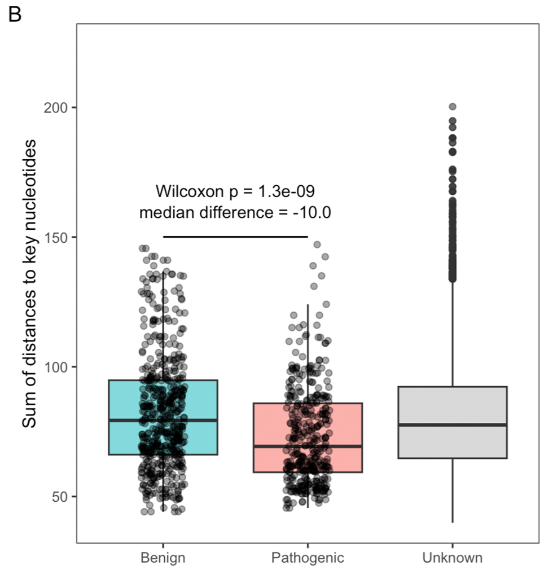

## Citation

Liebeskind, K., Francklyn, C., & **Barrantes-Reynolds, R.** (2026). [Structural distance to the tRNA-synthetase binding interface predicts pathogenicity but is captured by AlphaMissense and EVE.](https://doi.org/10.1371/journal.pone.0351982) *PLOS ONE*, 21(11), e0351982. https://doi.org/10.1371/journal.pone.0351982

## Summary

An important problem is to predict variant pathogenicity. Currently there are various AI-trained and other models that do this. Aminoacyl-tRNA synthetases have extensive variant data and well-characterized disease associations, and our group has extensive domain knowledge of them. We measured structural distances from each residue to the tRNA binding interface and found that pathogenic variants sit significantly closer to it than benign variants (p = 1.3e-09). However, adding distance to AlphaMissense and EVE in a Bayesian mixture model did not meaningfully improve prediction, suggesting those predictors already capture this structural context. A subset of interface variants that both predictors call ambiguous remains, and distance alone did not resolve them.

Here I worked closely with Kayla and Chris, and developed the Bayesian mixture model used and collaborated throughout on all aspects of the project. This taught me that we might need better domain features if we want to improve on these AI models.

